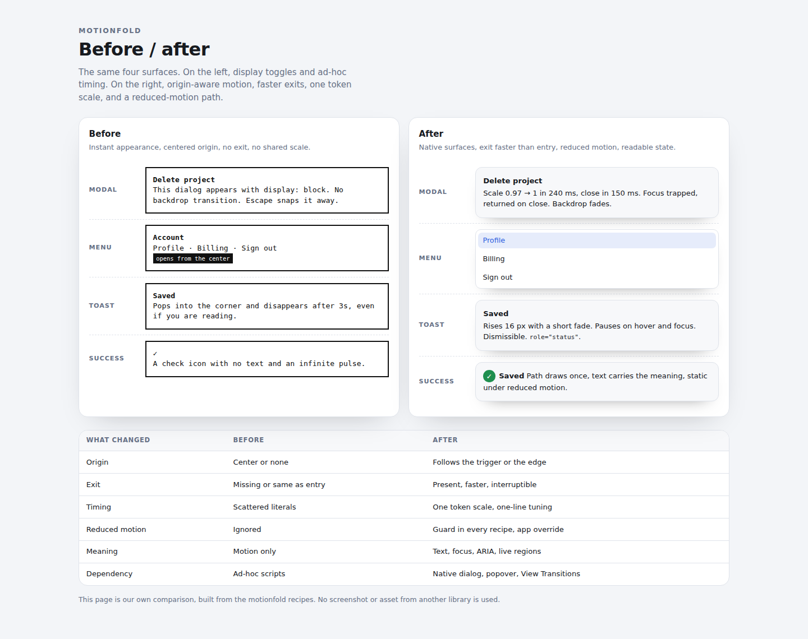
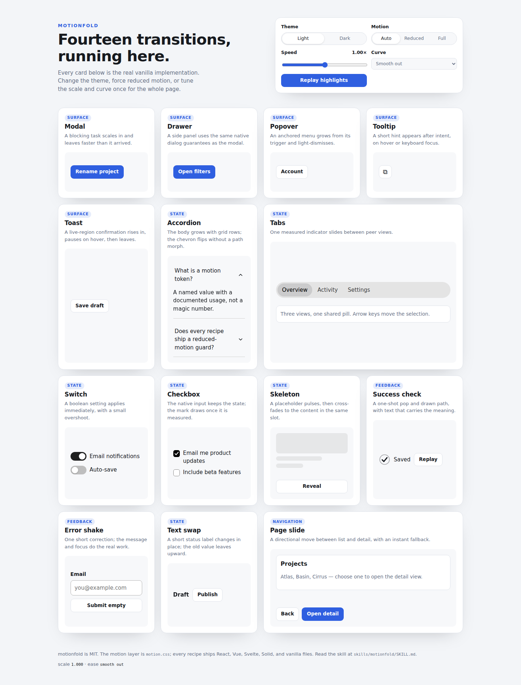

# ETUDE — `motionfold`

> Étude de conception pour un dépôt open source (MIT) qui donne aux agents de codage une
> bibliothèque de transitions d'interface soignées, portables sur **React, Vue, Svelte,
> Solid et CSS/JS pur**, avec **`prefers-reduced-motion` automatique**, des **durées et
> courbes réglables en une ligne**, et une **page de démo vivante**.
>
> Date : 2026-11-24 · Statut : étude terminée, implémentation à venir · Langue du produit :
> anglais · Nom de travail : **motionfold** · Propriétaire cible : `terravidhal`.

---

## 1. Résumé exécutif

Le dépôt à créer est un **skill** au sens Agent Skills : un dossier `skills/motionfold/`
contenant un `SKILL.md` avec frontmatter `name` / `description`, des références markdown, des
implémentations prêtes à copier, un petit script d'audit et des assets. Il s'installe en une
commande :

```bash
npx skills add terravidhal/motionfold
```

La valeur n'est pas d'inventer des effets spectaculaires. C'est de donner à l'agent :

1. un **vocabulaire de décision** (« ce composant a besoin de quelle transition, et
   pourquoi ? ») ;
2. des **recettes testées** pour les cas d'interface réels : surfaces qui s'ouvrent et se
   ferment, changements d'état, retours de succès/erreur, navigation ;
3. **le même comportement dans cinq stacks**, pas seulement en CSS + React ;
4. des **garde-fous d'accessibilité** (mouvement réduit, focus, ARIA, `inert`, régions
   live) appliqués par défaut, pas laissés à la mémoire de l'agent ;
5. un **réglage en une ligne** (échelle globale, courbe, ou durée d'une seule recette) ;
6. une **démo ouverte** que l'humain et l'agent peuvent lancer hors ligne, avec un mode
   « mouvement réduit » et un curseur de vitesse.

Décisions structurantes :

- **On n'embarque aucun code de la référence.** Le dépôt `transitions.dev` a une licence
  custom qui interdit la redistribution de sa bibliothèque comme produit concurrent ; on
  écrit nos propres recettes, nos propres textes et nos propres assets. On reprend des
  **idées** (échelle de tokens, asymétrie ouverture/fermeture, table de décision), pas des
  fichiers.
- **Quatorze recettes cœur**, pas quarante-six. Chaque recette est fournie pour les cinq
  stacks, avec une spécification unique et un validateur qui vérifie la parité. La qualité
  et la couverture priment sur le nombre.
- **Les primitives natives d'abord** : `<dialog>` (focus trap, Escape, top layer),
  Popover API (light dismiss, top layer), View Transitions API (navigation), `<details>`
  quand c'est possible. Moins de JavaScript, plus d'accessibilité gratuite.
- **Zéro dépendance à l'exécution.** Le skill installé ne tire aucune librairie ; le
  démonstrateur peut avoir des devDependencies, jamais le code copié dans le projet de
  l'utilisateur.
- **Licence MIT**, pas de compte, pas de clé, pas de télémétrie, pas de service payant.

---

## 2. Périmètre

### Dans le périmètre

- Un dépôt `motionfold` sous licence MIT, README et `SKILL.md` en anglais.
- Un skill `motionfold`, installable par `npx skills add`, compatible Claude Code, Codex,
  Cursor, Gemini CLI, GitHub Copilot, OpenCode et tout agent qui lit `SKILL.md`.
- Quatorze recettes de transitions UI, chacune avec :
  - une référence markdown (quand l'utiliser, quand l'éviter, anatomie, états, tokens,
    accessibilité, pièges) ;
  - une implémentation CSS + JS vanilla ;
  - une implémentation React, Vue, Svelte et Solid idiomatique ;
  - une entrée dans la démo et dans le manifeste.
- Une couche de tokens (`motion.css`) et des helpers de présence (ouverture/fermeture)
  par stack.
- Un audit déterministe local (`scripts/audit.mjs`) : scan, score, suggestions, aucune
  modification automatique.
- Une démo statique (vanilla) qui montre les quatorze transitions en vrai, en clair/sombre,
  avec mouvement réduit simulé et réglage de vitesse/courbe.
- Des captures Playwright Chromium (desktop/mobile, clair/sombre) et une image avant/après
  fabriquée par nous.
- Des evals, un validateur de dépôt, un workflow CI, un README « install first ».

### Hors périmètre

- Créer des animations vidéo, des motion graphics, des Lottie, des scènes 3D ou des effets
  de marque.
- Remplacer une librairie d'animation déjà installée (Motion/Framer Motion, GSAP, Anime.js)
  ou imposer une dépendance.
- Fournir un moteur de positionnement de popover, un routeur, un gestionnaire de formulaires
  ou un design system complet.
- Copier, republier ou adapter la bibliothèque `transitions.dev`, ses textes, ses captures ou
  ses dessins.
- Comptes, clés API, paiement, MCP, télémétrie, publication npm.
- Promettre un comportement identique au pixel près entre navigateurs : on promet un
  **contrat de mouvement** et des fallbacks documentés.

---

## 3. La référence : `transitions.dev`

### 3.1 Ce que c'est

`github.com/Jakubantalik/transitions.dev` — **6 499 étoiles** au 2026-11-24 (API GitHub),
présenté comme « UI motion agent, a library of 43+ crafted transitions, a skill that fits
your workflow ». Le dépôt contient bien plus qu'un skill :

- une bibliothèque de **46 démos** dans `transitions/` (35 gratuites, 11 Pro selon le
  catalogue du site) ;
- trois skills : `transitions-dev` (installer une transition), `transitions-polish`
  (retuner le mouvement existant), `transitions-ui-generation` (génération de squelettes et
  de textes) ;
- un **agent** (`agent/`) avec scanner, score, service de fix hébergé, MCP et GitHub Action ;
- un **CLI** (`cli/`) pour installer les recettes et les skills ;
- un site marketing complet avec démos, pages par transition, thème clair/sombre, MCP.

C'est la référence du sujet : elle a imposé une partie du vocabulaire (motion tokens,
open/close asymmetry, decision rules) et elle montre ce qu'un skill de mouvement peut être
quand il est traité comme un produit.

### 3.2 Arborescence observée

```text
transitions.dev/
├── skills/
│   ├── transitions-dev/          # 38 fichiers de recettes + SKILL.md + _root.css
│   ├── transitions-polish/       # audit/retune des valeurs existantes
│   └── transitions-ui-generation/# squelettes, textes, images
├── transitions/<slug>/index.html # 46 démos statiques
├── agent/                        # scanner, règles, score, fix, MCP, CI
├── cli/                          # installateur + manifeste gratuit
├── build/                        # extraction et templates de génération
├── scripts/                      # data JSON, builds communautaires, eval
├── assets/                       # polices, images, vidéos, tokens
└── LICENSE                       # licence custom, pas MIT pour les recettes
```

### 3.3 Le flux de l'agent

Le `SKILL.md` de `transitions-dev` est un routeur très travaillé :

1. **Table de référence** : 36 lignes « transition → quand l'utiliser → fichier ».
2. **Règles de décision** par élément visible et par verbe : « un trigger + une petite
   pastille au-dessus → notification badge », « deux écrans liste ↔ détail → page
   side-by-side », etc.
3. **Quatre commandes namespacées** (`transitions reveal`, `review`, `apply`, `refine`)
   pour éviter les collisions avec les autres skills.
4. **Échelle de motion tokens** en cinq dimensions : durée, easing, distance, scale, blur.
5. **Procédure d'installation** : copier `_root.css` une fois, coller le CSS de la recette
   verbatim, câbler les hooks HTML, conserver le bloc `prefers-reduced-motion`, copier le JS
   d'orchestration si nécessaire.
6. **Liste d'erreurs fréquentes** (reflow oublié, `setTimeout` de nettoyage, `stroke-dasharray`
   codé en dur, `transition: all`, etc.).
7. **Checklist finale** et contrat de sortie.

Le skill `transitions-agent` pousse plus loin : il fait lancer `npx transitions-agent@latest
--json`, lit le score (0–100), présente deux options (polish ou revamp), vérifie la licence,
puis relance le scan. Le fix est un service hébergé ; le scan et le CLI sont MIT, les recettes
Pro et le fix sont payants.

### 3.4 Méthodes techniques

Ce qui fait la solidité de la bibliothèque :

- **Namespacing systématique** : classes `t-*`, variables `--<recette>-*`, attributs
  `data-*`. Pas de collision avec le projet hôte.
- **Une recette = un fichier autonome** : CSS, tableau de variables, HTML d'usage, JS
  d'orchestration, garde de mouvement réduit. On peut installer une seule transition sans
  le reste.
- **Tokens sémantiques** : `--duration-quick` (150 ms) pour les fermetures de modal/dropdown,
  `--duration-fast` (250 ms) pour les ouvertures, `--ease-smooth-out`
  (`cubic-bezier(0.22, 1, 0.36, 1)`), `--blur-small` (2 px), `--scale-large` (0.96), etc.
- **Asymétrie ouverture/fermeture** : les surfaces s'ouvrent plus lentement qu'elles ne se
  ferment ; les fermetures « sortent du chemin ».
- **Orchestration JS minimale** : pour les surfaces qui doivent rester montées pendant la
  sortie, le skill lit la durée via `getComputedStyle(...).getPropertyValue("--…")` et
  nettoie la classe de fermeture avec `setTimeout`.
- **Mouvement réduit au niveau du snippet** : chaque recette fournit son bloc
  `@media (prefers-reduced-motion: reduce)` et le documente comme obligatoire.
- **React auto-contenu** : le composant React injecte son CSS dans un `<style>` avec un id
  stable, pour qu'un seul fichier suffise. SSR-safe par un test `typeof document`.
- **Démo marketing** : pages statiques par transition, démo live, thème clair/sombre,
  captures, vidéos, GIF.

### 3.5 Ce qui fait sa qualité

1. **Une promesse claire** : « des transitions UI prêtes pour la production, copiables ».
2. **Une table de décision excellente** : on choisit par élément et par intention, pas par
   nom d'effet. C'est le vrai mécanisme de qualité.
3. **Une échelle de mouvement cohérente** : les valeurs ne sont pas des nombres magiques,
   elles ont un usage documenté.
4. **Une divulgation progressive** : le `SKILL.md` route, les fichiers de recette
   contiennent le détail, le site contient la démo.
5. **Une discipline de documentation** : chaque recette dit quand l'utiliser, quelles
   variables existent, quel HTML câbler, quel JS copier, quels pièges éviter.
6. **Une vérification finale** : checklist, erreurs fréquentes, contrat de sortie.
7. **Un écosystème** : CLI, agent, MCP, CI, plans. Le skill n'est pas un fichier isolé.

### 3.6 Limites observées

Ce sont nos angles d'attaque, pas des critiques gratuites.

| Limite | Conséquence | Notre réponse |
|---|---|---|
| **Licence custom** : usage libre, mais interdiction de republier la bibliothèque comme produit concurrent | On ne peut pas partir de leur code pour un skill MIT | Tout est réécrit ; on ne copie ni CSS, ni textes, ni assets |
| **CSS + React seulement** | Un projet Vue/Svelte/Solid doit traduire à la main | Cinq stacks natives, même contrat |
| **Le CSS est dupliqué dans chaque composant React** | Tokens éparpillés, poids, FOUC/SSR à gérer | Un `motion.css` partagé ; les composants ne possèdent que la logique |
| **Le nettoyage de fermeture utilise `setTimeout` + parsing de durée** | Dérive si `calc()`, si mouvement réduit, si transition interrompue | `transitionend` / `animationend` + fallback, état de présence interruptible |
| **Mouvement réduit recette par recette** | Oubli facile, pas d'override applicatif | Bloc obligatoire + override `data-motion="reduced|full"` + helper JS + test |
| **38 fichiers de recettes, 35 dans le CLI, 46 sur le site, « 43+ » dans le README** | Plusieurs sources de vérité, catalogue qui dérive | Un manifeste `recipes.json` validé par le script de check |
| **Accessibilité limitée au mouvement** | Pas de focus trap, pas d'`inert`, pas de scroll lock, pas de live region | Contrat a11y par recette, primitives natives, checklist |
| **Expérience React auto-injectée** | Difficile à auditer, à tree-shaker, à styler avec le design system | CSS explicitement importé, composants sans injection |
| **Fix hébergé payant, MCP avec clé** | La valeur « correction » n'est pas libre | Audit local déterministe, MIT, sans réseau ni compte |
| **Recettes nombreuses mais très décoratives** (confetti, gooey, smoky, tilt) | Bruit pour un agent qui doit choisir | 14 recettes cœur, orientées produit, avec règles d'exclusion |
| **Pas de démo open-source auto-hébergeable** | On ne peut pas vérifier hors ligne | Démo statique zéro dépendance + captures Playwright |
| **Pas de parity test multi-framework** | La promesse « portable » n'est pas prouvée | Un harnais Vite à 5 entrées + smoke test navigateur |

### 3.7 Ce qu'on reprend (idées, pas fichiers)

- La **table de décision** par élément et par intention.
- L'**échelle de tokens** et l'idée qu'un token a un *usage*, pas seulement une valeur.
- L'**asymétrie ouverture/fermeture** et l'idée qu'une fermeture doit être plus rapide.
- Le **principe de fréquence** : plus une action est fréquente, moins elle doit animer.
- Le **namespacing** et l'autonomie d'une recette.
- La **garde de mouvement réduit** dans chaque recette.
- La **checklist finale** et les « erreurs fréquentes ».
- L'**audit par usage** : on ne remplace pas un nombre parce qu'il est proche, on le remplace
  parce que son usage correspond à un autre token.

### 3.8 Licence : un point important

Le dépôt contient un `LICENSE` custom, contrairement à l'hypothèse « aucune licence ». Le
texte autorise l'usage personnel et commercial, la modification et l'intégration dans des
produits, mais **interdit de repackager, revendre ou publier la collection (ou une partie
substantielle) comme une bibliothèque de transitions concurrente**. Le tooling (`agent/`,
`cli/`, `build/`, `scripts/`) est MIT ; les recettes ne le sont pas.

Conclusion opérationnelle : **on ne copie aucun fichier de recette, aucun texte de recette,
aucune capture, aucun dessin.** On peut étudier les méthodes, les comparer, et écrire une
bibliothèque originale. C'est ce que fait ce dépôt.

---

## 4. Trois autres skills du même sujet

Méthode : lecture des README, `SKILL.md`, arborescences et références publiques. Les étoiles
sont celles de l'API GitHub au 2026-11-24 ; elles servent de signal, pas de critère.

### 4.1 `LottieFiles/motion-design-skill` — ≈3 651 étoiles

**Nature.** Un skill de **principes** de motion design : durée, easing, chorégraphie,
principes Disney adaptés à l'UI, personnalité de marque, mapping émotion → mouvement.

**Structure.** Un `SKILL.md` de 330 lignes, puis `director/` (philosophie, décision,
chorégraphie, narration, personnalité), `reference/` (tableaux de timing, sélection de
propriétés, checklist, troubleshooting) et `patterns/` (entrée/sortie, feedback, ambient,
multi-éléments).

**Forces.** La taxonomie est excellente ; les tableaux de durée/easing sont directement
utilisables ; la checklist en 8 étapes et les trois piliers (intention émotionnelle, récit,
craft) donnent un langage commun. Le skill couvre CSS, Framer Motion, GSAP, Lottie.

**Limites.** Ce sont des principes, pas des recettes copiables. Aucun composant, aucun test,
aucune démo. Le skill est très large et peut pousser à sur-animer. La personnalité de marque
est utile pour du marketing, moins pour un dashboard produit.

**Ce qu'on prend.** La hiérarchie des décisions, le principe « entrée plus longue que
sortie », le budget de stagger, la distinction propriété primaire/secondaire. On garde un
scope produit plus étroit.

### 4.2 `kylezantos/design-motion-principles` — ≈1 648 étoiles

**Nature.** Un skill « expert » en deux modes : **Create** (construire) et **Audit**
(évaluer), avec trois lentilles (Emil Kowalski, Jakub Krehel, Jhey Tompkins), une gate de
fréquence, et un rapport HTML brandé avec des démos en boucle.

**Structure.** `SKILL.md` court, `workflows/create.md`, `workflows/audit.md`, des références
par designer, `motion-cookbook.md`, `audit-checklist.md`, `anti-checklist.md`,
`accessibility.md`, `performance.md`, `output-format.md`, `demo-shell.html`.

**Forces.** La **gate de fréquence** (« 100+ fois/jour → pas d'animation ») est un excellent
garde-fou. Le mode audit avec rapport visuel est une vraie expérience. La séparation
création/audit est claire. L'accessibilité est traitée comme non optionnelle.

**Limites.** Le contenu est éditorial et dépend d'une interprétation de designers ; ce n'est
pas une bibliothèque de recettes. Le rapport HTML et le branding ajoutent de la surface. Le
skill ne fournit pas de code multi-framework.

**Ce qu'on prend.** La gate de fréquence, la séparation « construire / auditer », l'idée
d'un rapport lisible, et la discipline « le meilleur mouvement est celui qu'on ne remarque
pas ».

### 4.3 `master5d/claude-design-skills` — ≈43 étoiles

**Nature.** Une collection de skills de design engineering inspirés d'Emil Kowalski :
`emil-design-eng`, `fixing-motion-performance`, `fixing-accessibility`, `interface-design`,
`baseline-ui`, `fixing-metadata`.

**Forces.** `emil-design-eng` est un concentré de règles actionnables : ne jamais animer une
action clavier, éviter `transition: all`, ne pas partir de `scale(0)`, rendre les popovers
origin-aware, préférer les transitions aux keyframes pour l'interruptible, utiliser le blur
pour masquer un crossfade, `@starting-style`, `prefers-reduced-motion` (réduire, pas
supprimer). Le format de revue Before/After/Why est excellent.

**Limites.** Ce sont des règles et des exemples, pas une bibliothèque installable. Pas de
multi-framework, pas de démo complète, pas de manifeste.

**Ce qu'on prend.** Le format de revue, les règles de performance, la nuance sur le mouvement
réduit (garder l'opacité et la couleur, retirer le déplacement), et l'idée que les détails
invisibles se cumulent.

### 4.4 `domedad/frontend-animation-patterns` — ≈32 étoiles

**Nature.** Un catalogue de patterns front-end (Bklit UI, Sakani UI, UIArc, EasyUI,
Beautiful UI, Rewamp UI, beUI, COSS UI, React Bits, Transitions.dev, Magic UI,
MicroInteractions UI), avec une matrice de sélection et des références par source.

**Forces.** La matrice de sélection et la discipline « lire la source, vérifier les
dépendances, ne pas copier le thème » sont utiles. Le catalogue couvre beaucoup de cas.

**Limites.** **Le skill désactive explicitement le respect de `prefers-reduced-motion` par
défaut** : il demande de ne pas suivre le réglage système. C'est un choix éditorial fort,
mais incompatible avec notre position. Le catalogue est très React/shadcn et dépend de
sources tierces dont les licences sont hétérogènes.

**Ce qu'on prend.** La matrice de sélection et la prudence sur les licences. On fait
l'inverse sur le mouvement réduit : il est automatique et non négociable, avec un override
applicatif explicite.

### 4.5 Tableau comparatif

| Dépôt | Nature | Force | Limite | Notre différence |
|---|---|---|---|---|
| `transitions.dev` | Bibliothèque + skills + agent + CLI | Décision, tokens, finition, écosystème | Licence non réutilisable, CSS+React, fix payant | MIT, 5 stacks, natif, audit libre |
| `motion-design-skill` | Principes | Taxonomie, tableaux, personnalité | Pas de recettes ni de code | Recettes exécutables + principes courts |
| `design-motion-principles` | Principes + audit | Gate de fréquence, rapport, 3 lentilles | Éditorial, pas de multi-framework | Un contrat unique + implémentations |
| `claude-design-skills` | Règles design engineering | Règles actionnables, format de revue | Pas de bibliothèque | Bibliothèque + règles |
| `frontend-animation-patterns` | Catalogue de sources | Matrice, couverture | Reduced motion désactivé, licences floues | A11y par défaut, code original MIT |

### 4.6 Ce que le marché laisse ouvert

1. **La parité multi-framework** : presque tout est CSS + React, ou React/shadcn.
2. **L'accessibilité par défaut** : beaucoup de skills parlent de mouvement réduit, peu
   l'appliquent dans chaque recette avec un override applicatif et des tests.
3. **Le réglage simple** : les tokens existent, mais le « une ligne pour tout régler » est
   rare.
4. **L'audit libre et local** : les scanners intéressants sont souvent liés à un service.
5. **Une démo ouverte** : les démos sont des sites marketing, pas des harnais exécutables.
6. **Un scope produit** : les catalogues de 46 effets sont impressionnants mais difficiles à
   choisir ; un set curé de 14 recettes avec des règles d'exclusion est plus utile à un
   agent.

---

## 5. Nos améliorations

1. **Cinq stacks, un contrat.** Chaque recette a une spécification unique et cinq
   implémentations idiomatiques. Le validateur vérifie que les cinq existent et que la démo
   les référence.
2. **Un seul fichier de tokens.** `motion.css` définit l'échelle et les variables de recette.
   Pas de CSS dupliqué dans chaque composant, pas d'injection de `<style>`.
3. **Réglage en une ligne.** `--mf-scale`, `--mf-ease`, `--mf-distance` pour tout ; une
   variable `--mf-<recette>-duration` pour une seule recette ; des props `duration` /
   `easing` dans chaque framework.
4. **Mouvement réduit automatique et testé.** Chaque CSS contient son bloc
   `prefers-reduced-motion` ; un override `data-motion="reduced|full"` permet de simuler ou
   de forcer ; les composants JS lisent la préférence pour la durée de sortie.
5. **Primitives natives.** `<dialog>` pour modal/drawer (focus trap, Escape, top layer),
   Popover API pour les menus, View Transitions pour la navigation, inputs natifs pour
   switch/checkbox. Moins de code, plus d'accessibilité.
6. **Cycle de présence robuste.** On écoute `transitionend` / `animationend` avec un fallback ;
   on gère les fermetures interrompues, le double-clic, le démontage et le mouvement réduit.
7. **Contrat d'accessibilité explicite.** Focus initial et retour, `inert` sur le fond,
   scroll lock, `aria-expanded` / `aria-controls` / `aria-selected` / `aria-live`,
   `role="alert"` / `role="status"`, et « jamais le mouvement seul ».
8. **Audit local déterministe.** Un script Node sans dépendance scanne le projet, score,
   explique, suggère une recette. Aucun réseau, aucune clé, aucune modification.
9. **Un manifeste, pas quatre.** `recipes.json` est la source de vérité ; le README, le
   `SKILL.md`, la démo et le validateur en dérivent ou le vérifient.
10. **Scope curé.** 14 recettes produit, avec des règles d'exclusion et une gate de
    fréquence. Les effets décoratifs (confetti, gooey, smoky, tilt, odometer) sont hors v1.
11. **Démo ouverte.** Une page statique sans build, avec tous les cas, thème clair/sombre,
    mouvement réduit simulé, vitesse et courbe réglables, replay.
12. **Zéro dépendance installée.** Le skill ne tire rien ; le projet de l'utilisateur ne
    reçoit que du CSS, du JS ou un composant qui n'importe que son framework.
13. **MIT et transparence.** Licence claire, aucun secret, aucune télémétrie, aucun service.
    Le README invite à lire les fichiers avant installation.

---

## 6. Nom et disponibilité

### 6.1 Candidats

Le nom doit être court, prononçable, distinct de `transitions.dev`, et disponible à la fois
comme dépôt GitHub sous `terravidhal` et comme paquet npm (même si on ne publie pas npm, le
nom doit être libre pour éviter les collisions).

| Nom | GitHub `terravidhal/*` | npm | Écosystème | Verdict |
|---|---|---|---|---|
| `motionkit` | libre | libre (404) | 1 080★ iOS MotionKit, plugin Figma, paquets scoped, `motionkit-skills` | Trop encombré |
| `motion-kit` | libre | **pris** (0.0.6) | RubyMotion, SaaS motion kits | Non |
| `easekit` | libre | **non publiable** (dépublié en 2023) | EaseKit Swift, outil After Effects | Risqué |
| `motiondeck` | libre | libre | Slideshows, decks animés | Correct, mais « deck » = diapositives |
| `motionfold` | **libre** | **libre** (404) | Aucun dépôt exact, aucun paquet | **Retenu** |
| `motionloom` | libre | pris (2.7.0) | Studio p5.js | Non |
| `motionweave` | libre | libre | Projets de recherche 3D | `motionfold` plus court |

### 6.2 Vérifications

`gh` n'est pas installé dans cet environnement. Les vérifications équivalentes ont été
faites le **2026-11-24** via l'API GitHub et le registre npm :

```text
GET https://api.github.com/repos/terravidhal/motionfold   → 404 (libre)
GET https://api.github.com/repos/terravidhal/motiondeck   → 404 (libre)
GET https://api.github.com/repos/terravidhal/easekit      → 404 (libre)
GET https://registry.npmjs.org/motionfold                 → 404 (libre)
GET https://registry.npmjs.org/motionkit                  → 404 (libre, mais écosystème encombré)
GET https://api.github.com/search/repositories?q=motionfold+in:name → 0 résultat exact
```

La commande demandée (`gh repo view terravidhal/motionfold`) donnera le même résultat dès
que `gh` sera disponible. On note aussi que `npm view motionfold` renvoie `E404`, donc le nom
est libre côté npm.

### 6.3 Décision

- **Dépôt** : `terravidhal/motionfold`
- **Skill** : `motionfold`
- **Installation** : `npx skills add terravidhal/motionfold`
- **Classe CSS** : `mf-*`
- **Variables** : `--mf-*`
- **Attributs** : `data-mf-*`, `data-motion`, `data-state`

« fold » évoque le pli, le passage d'un état à un autre, et le fait de replier une surface.
Le nom est court, sans collision, et ne prétend pas être une bibliothèque de motion graphics.
La baseline produit sera : **« A deck of polished UI transitions for every stack — accessible
by default, tunable in one line. »**

---

## 7. Architecture du dépôt

### 7.1 Arborescence cible

```text
motionfold/
├── README.md
├── LICENSE                         # MIT
├── CONTRIBUTING.md
├── ETUDE.md                        # ce document
├── package.json                    # scripts de dev uniquement, zéro runtime
├── .gitignore                      # ref/, node_modules/, dist/, .vague/
├── .github/workflows/check.yml
├── evals/evals.json
├── assets/
│   ├── readme/                     # captures desktop/mobile, clair/sombre
│   ├── before-after.png
│   └── demo.gif                    # optionnel
├── examples/
│   ├── index.html                  # démo statique vanilla, zéro build
│   ├── demo.css
│   ├── demo.js
│   ├── before-after.html
│   ├── server.mjs                  # petit serveur statique sans dépendance
│   ├── stacks/                     # harnais Vite 5 entrées (React/Vue/Svelte/Solid/vanilla)
│   └── scripts/
│       ├── capture.mjs             # Playwright Chromium
│       └── smoke.mjs               # vérifie les 14 recettes + reduced motion
├── scripts/
│   ├── check-skill.mjs             # validateur du dépôt
│   └── audit-test.mjs              # fixtures pour l'audit
└── skills/motionfold/
    ├── SKILL.md
    ├── recipes.json                # manifeste : 14 recettes, familles, tokens, fichiers
    ├── references/
    │   ├── choosing.md             # décision, gate de fréquence, budget de mouvement
    │   ├── tokens.md               # échelle, réglage une ligne, migration
    │   ├── accessibility.md        # reduced motion, focus, ARIA, live regions
    │   ├── stacks.md               # React/Vue/Svelte/Solid/vanilla, SSR, Tailwind
    │   ├── audit.md                # règles du scanner, faux positifs
    │   ├── troubleshooting.md
    │   └── recipes/
    │       ├── modal.md
    │       ├── drawer.md
    │       ├── popover.md
    │       ├── tooltip.md
    │       ├── toast.md
    │       ├── accordion.md
    │       ├── tabs.md
    │       ├── switch.md
    │       ├── checkbox.md
    │       ├── skeleton.md
    │       ├── success-check.md
    │       ├── error-shake.md
    │       ├── text-swap.md
    │       └── page-slide.md
    ├── implementations/
    │   ├── _shared/
    │   │   ├── motion.css          # tokens + base + override reduced motion
    │   │   ├── presence.react.ts
    │   │   ├── presence.vue.ts
    │   │   ├── presence.svelte.ts
    │   │   ├── presence.solid.ts
    │   │   ├── presence.vanilla.js
    │   │   └── view-transition.ts
    │   ├── modal/
    │   │   ├── style.css
    │   │   ├── vanilla.js
    │   │   ├── react.tsx
    │   │   ├── vue.vue
    │   │   ├── svelte.svelte
    │   │   └── solid.tsx
    │   ├── drawer/ ...
    │   └── ... (14 dossiers)
    └── scripts/
        └── audit.mjs               # scan local, sans dépendance
```

### 7.2 Le manifeste

`skills/motionfold/recipes.json` est la source de vérité. Exemple :

```json
{
  "name": "motionfold",
  "version": 1,
  "recipes": [
    {
      "slug": "modal",
      "title": "Modal",
      "family": "surface",
      "when": "A blocking decision or focused task that needs the page to wait.",
      "notWhen": "A non-blocking confirmation (toast) or a contextual menu (popover).",
      "primitive": "dialog",
      "tokens": ["--mf-modal-duration", "--mf-modal-ease", "--mf-modal-distance"],
      "a11y": ["focus-trap", "escape", "focus-return", "scroll-lock", "aria-modal"],
      "files": ["style.css", "vanilla.js", "react.tsx", "vue.vue", "svelte.svelte", "solid.tsx"],
      "demo": "modal"
    }
  ]
}
```

Le validateur vérifie que chaque `slug` a ses six fichiers, sa référence, son entrée de
démo, ses tokens et son bloc de mouvement réduit.

### 7.3 Conventions

- **Classes** : `mf-<recette>`, `mf-<recette>-<partie>` (`mf-modal`, `mf-modal-panel`).
- **État** : `data-state="open|closed|opening|closing"`, `data-side`, `data-open`.
- **Attributs ARIA** : natifs d'abord (`aria-expanded`, `aria-selected`, `aria-checked`,
  `aria-busy`, `aria-live`, `aria-describedby`).
- **Tokens** : `--mf-<recette>-duration`, `--mf-<recette>-ease`, `--mf-<recette>-distance`.
- **Une recette = un dossier**. Pas de fichier fourre-tout.
- **Aucune dépendance** dans les implémentations : seulement le framework et le CSS.
- **Pas de `transition: all`**, pas de durée codée en dur hors fallback, pas d'animation de
  layout sans justification documentée.
- **Chaque CSS** contient un bloc `@media (prefers-reduced-motion: reduce)`.
- **Chaque composant** accepte `duration`, `easing` et `distance` quand c'est pertinent.

### 7.4 Ce que l'installation copie

`npx skills add` copie le dossier `skills/motionfold/` — donc le `SKILL.md`, les références,
les implémentations, le manifeste et le script d'audit. Le README, les exemples, les evals,
les captures et la CI restent dans le dépôt et ne sont pas installés. C'est le bon niveau :
l'agent reçoit tout ce qu'il doit lire et copier, sans le bruit marketing.

---

## 8. La bibliothèque : 14 transitions

### 8.1 Tableau des recettes

| # | Slug | Famille | Quand l'utiliser | Quand l'éviter | Primitive |
|---|---|---|---|---|---|
| 1 | `modal` | surface | Décision bloquante, tâche focalisée | Confirmation non bloquante, menu contextuel | `<dialog>` |
| 2 | `drawer` | surface | Panneau latéral, navigation, filtres | Menu court, alerte bloquante | `<dialog>` stylé |
| 3 | `popover` | surface | Menu contextuel ancré, actions | Décision bloquante, navigation principale | Popover API |
| 4 | `tooltip` | surface | Indice complémentaire au survol/focus | Information essentielle, cible tactile seule | CSS + ARIA |
| 5 | `toast` | surface | Confirmation asynchrone, statut transitoire | Erreur qui exige une action, information persistante | Région live |
| 6 | `accordion` | état | FAQ, réglages, divulgation progressive | Navigation principale, contenu toujours visible | Bouton + région |
| 7 | `tabs` | état | Vues pair-à-pair, segmented control | Étapes séquentielles, navigation de page | Tablist |
| 8 | `switch` | état | Réglage booléen appliqué immédiatement | Choix de formulaire soumis plus tard | Bouton `role="switch"` |
| 9 | `checkbox` | état | Sélection multiple, consentement | Réglage instantané | `<input>` natif |
| 10 | `skeleton` | état | Chargement dont la structure est connue | Attente très courte ou inconnue | CSS + `aria-busy` |
| 11 | `success-check` | feedback | Confirmation d'une action terminée | Signal unique sans texte, état persistant sans contexte | SVG + `role="status"` |
| 12 | `error-shake` | feedback | Validation échouée, saisie invalide | Erreur système, erreur déjà annoncée | `role="alert"` |
| 13 | `text-swap` | état | Libellé de statut qui change sur place | Paragraphe long, contenu principal | Deux couches + live |
| 14 | `page-slide` | navigation | Passage liste ↔ détail, étape ↔ étape | Navigation très fréquente au clavier | View Transitions |

### 8.2 Contrat d'implémentation

Chaque recette respecte le même contrat, quel que soit le stack :

1. **Un état explicite** : `data-state` (ou l'attribut natif `open`, `aria-expanded`,
   `aria-checked`, `aria-selected`). Pas d'animation déclenchée par un `setTimeout` qui
   devine l'état.
2. **Une entrée et une sortie** : la sortie est plus rapide que l'entrée (sauf mouvement
   réversible symétrique documenté : tabs, accordéon).
3. **Un token par dimension** : durée, courbe, distance ; valeurs par défaut dans
   `motion.css`, override local possible.
4. **Un bloc de mouvement réduit** : déplacement supprimé, opacité/couleur conservées si
   elles aident à comprendre ; durée quasi nulle pour la sortie.
5. **Une accessibilité native** : focus, clavier, ARIA, `inert`, scroll lock, live region
   selon la recette.
6. **Aucune animation de layout** sans justification : `height`/`width` sont évités au profit
   de `transform`/`opacity` ; les exceptions (accordéon en `grid-template-rows`, indicateur
   d'onglets en `width`) sont documentées.
7. **Un nettoyage fiable** : `transitionend` / `animationend` + fallback, gestion des
   interruptions, pas de `setTimeout` magique.
8. **Un exemple vanilla complet** : la démo prouve que le CSS et le JS fonctionnent sans
   framework.

### 8.3 Détail par recette

#### 1. Modal

- **Rôle** : concentrer l'attention sur une décision ou une tâche courte.
- **Primitive** : `<dialog>` + `showModal()`. Focus trap, Escape, top layer et retour du
  focus sont natifs.
- **Mouvement** : opacité + `translateY(8px)` + `scale(0.97)` à l'ouverture ; fermeture plus
  rapide, sans déplacement excessif. Backdrop en opacité.
- **A11y** : `aria-labelledby`, `aria-describedby`, focus initial sur le premier champ ou le
  bouton principal, `inert` implicite du fond (top layer), scroll lock via
  `html:has(dialog[open])`.
- **Pièges** : ne pas fermer instantanément avec `display:none` ; intercepter `cancel` pour
  animer la sortie ; rendre le focus au déclencheur ; ne pas empiler deux modals sans
  intention.
- **Tokens** : `--mf-modal-duration`, `--mf-modal-ease`, `--mf-modal-distance`,
  `--mf-modal-scale`.

#### 2. Drawer

- **Rôle** : panneau latéral pour navigation, filtres, détails.
- **Primitive** : `<dialog>` positionné à droite (ou à gauche), plein hauteur.
- **Mouvement** : translation depuis le bord + opacité ; fermeture rapide ; backdrop.
- **A11y** : mêmes garanties que modal ; `aria-label` sur le panneau ; focus sur le premier
  élément utile ; `inert` du fond.
- **Pièges** : ne pas animer `right`/`left` ; utiliser `transform: translateX(100%)` ;
  respecter les safe areas mobiles ; ne pas casser le scroll interne.
- **Tokens** : `--mf-drawer-duration`, `--mf-drawer-ease`, `--mf-drawer-distance`.

#### 3. Popover

- **Rôle** : menu contextuel ou panneau d'actions ancré à un déclencheur.
- **Primitive** : Popover API (`popover`, `showPopover()`, `hidePopover()`) pour le top layer
  et le light dismiss. Le positionnement fin reste la responsabilité du projet (Radix,
  Floating UI, anchor positioning) ; la recette fournit la couche de mouvement et l'état.
- **Mouvement** : `scale(0.97)` + `translateY(4px)` + opacité, `transform-origin` selon le
  côté (`data-side`). Fermeture rapide.
- **A11y** : `aria-expanded`, `aria-controls`, `role="menu"` si menu, focus sur le premier
  item, flèches, Escape, retour du focus.
- **Pièges** : ne pas utiliser `transform-origin: center` pour un popover ; ne pas laisser le
  popover dans le flux ; gérer le repositionnement au scroll.
- **Tokens** : `--mf-popover-duration`, `--mf-popover-ease`, `--mf-popover-distance`.

#### 4. Tooltip

- **Rôle** : indice complémentaire, jamais information essentielle.
- **Primitive** : CSS `:hover` / `:focus-visible` + `aria-describedby`. Délai d'intention
  (80 ms) pour éviter les ouvertures accidentelles ; une fois ouvert, les tooltips voisins
  peuvent s'ouvrir sans délai.
- **Mouvement** : opacité + `translateY(2px)` + `scale(0.98)` ; sortie instantanée.
- **A11y** : le contenu du tooltip doit être accessible au focus clavier ; ne pas le mettre
  dans un `title` seul ; éviter sur tactile.
- **Pièges** : ne pas capturer le pointeur ; ne pas masquer le déclencheur ; gérer les
  viewports étroits.
- **Tokens** : `--mf-tooltip-duration`, `--mf-tooltip-delay`, `--mf-tooltip-ease`.

#### 5. Toast

- **Rôle** : confirmer une action asynchrone sans bloquer.
- **Primitive** : pile de toasts, région `role="status"` / `aria-live="polite"`, auto-dismiss
  avec pause au survol/focus.
- **Mouvement** : entrée depuis le bas (ou le côté) avec opacité + translation + scale ;
  sortie plus rapide ; les toasts existants se décalent.
- **A11y** : texte lisible, pas de mouvement seul, bouton de fermeture, durée suffisante
  (5–8 s), pause quand la page est cachée.
- **Pièges** : ne pas voler le focus ; ne pas empiler plus de 3–4 toasts ; ne pas animer la
  hauteur de la pile avec `height`.
- **Tokens** : `--mf-toast-duration`, `--mf-toast-ease`, `--mf-toast-distance`.

#### 6. Accordion

- **Rôle** : divulguer un contenu dans un espace contraint.
- **Primitive** : bouton `aria-expanded` + région `aria-controls` ; grille
  `grid-template-rows: 0fr → 1fr` ; `inert` quand fermé.
- **Mouvement** : hauteur + opacité + léger blur ; chevron qui pivote ; 250 ms symétrique.
- **A11y** : `aria-expanded`, `aria-controls`, focus visible, `inert` sur le contenu fermé,
  navigation clavier.
- **Pièges** : padding sur la piste `0fr` (laisse une bande) ; chevron morphé via `d:`
  (Chromium seulement) → préférer une rotation/`scaleY`.
- **Tokens** : `--mf-accordion-duration`, `--mf-accordion-ease`.

#### 7. Tabs

- **Rôle** : basculer entre des vues pair-à-pair.
- **Primitive** : `role="tablist"`, boutons `role="tab"`, panneaux `role="tabpanel"`,
  roving tabindex, flèches/Home/End.
- **Mouvement** : indicateur qui glisse (transform + width), texte qui change de couleur ;
  250 ms symétrique.
- **A11y** : `aria-selected`, `aria-controls`, `tabindex` géré, focus sur l'onglet actif.
- **Pièges** : mesurer l'indicateur au premier rendu sans transition ; gérer le resize ;
  ne pas utiliser `display:none` sur le panneau actif sans transition.
- **Tokens** : `--mf-tabs-duration`, `--mf-tabs-ease`, `--mf-tabs-indicator-bg`.

#### 8. Switch

- **Rôle** : réglage booléen appliqué immédiatement.
- **Primitive** : bouton `role="switch"` + `aria-checked`, ou input natif stylé.
- **Mouvement** : translation du pouce avec une courbe légèrement overshoot ; piste en
  couleur ; 180–250 ms.
- **A11y** : nom accessible, espace/entrée, focus visible, contraste de la piste.
- **Pièges** : ne pas animer `left` ; ne pas déclencher l'animation au montage ; ne pas
  utiliser un switch pour un choix de formulaire.
- **Tokens** : `--mf-switch-duration`, `--mf-switch-ease`, `--mf-switch-travel`.

#### 9. Checkbox

- **Rôle** : sélection multiple ou consentement dans un formulaire.
- **Primitive** : `<input type="checkbox">` natif + label.
- **Mouvement** : remplissage + tracé du check en `stroke-dashoffset` ; 150–250 ms.
- **A11y** : label associé, focus visible, état natif, `aria-describedby` pour l'aide.
- **Pièges** : `stroke-dasharray` codé en dur sans mesurer le path ; hit area trop petite ;
  contraste insuffisant.
- **Tokens** : `--mf-checkbox-duration`, `--mf-checkbox-ease`.

#### 10. Skeleton

- **Rôle** : montrer la structure pendant un chargement.
- **Primitive** : conteneur `aria-busy="true"` + placeholders ; révélation du contenu réel
  par cross-fade.
- **Mouvement** : pulsation/shimmer en `linear` (ou statique si mouvement réduit) ; entrée du
  contenu en opacité + léger `translateY`, 300–400 ms.
- **A11y** : `aria-busy`, éviter d'annoncer chaque placeholder, annoncer le contenu prêt.
- **Pièges** : shimmer sur de grandes surfaces (coût), animation infinie oubliée hors écran,
  layout shift quand le contenu arrive.
- **Tokens** : `--mf-skeleton-duration`, `--mf-skeleton-ease`,
  `--mf-skeleton-reveal-duration`.

#### 11. Success check

- **Rôle** : confirmer qu'une action est terminée.
- **Primitive** : SVG + `role="status"` + texte visible (« Saved »).
- **Mouvement** : fade + rotation + tracé du check ; 400–500 ms ; rejouable.
- **A11y** : le texte porte le sens ; l'icône est décorative ou nommée ; ne jamais utiliser
  le mouvement seul ; `aria-live` pour annoncer.
- **Pièges** : `stroke-dasharray` non mesuré ; animation qui se relance au montage ; durée
  trop longue.
- **Tokens** : `--mf-check-duration`, `--mf-check-ease`, `--mf-check-draw`.

#### 12. Error shake

- **Rôle** : signaler une saisie invalide.
- **Primitive** : message `role="alert"` + `aria-invalid` sur le champ.
- **Mouvement** : secousse horizontale courte (2–3 oscillations, 300–400 ms), puis retour ;
  bordure/couleur stable.
- **A11y** : le message texte est la source de vérité ; pas de secousse si mouvement réduit ;
  ne pas secouer tout le formulaire.
- **Pièges** : secousse en boucle, `translate` sur un conteneur qui contient du texte
  sélectionnable, oubli du focus sur le champ invalide.
- **Tokens** : `--mf-shake-duration`, `--mf-shake-distance`, `--mf-shake-ease`.

#### 13. Text swap

- **Rôle** : faire changer un libellé de statut sur place.
- **Primitive** : deux couches (ancienne/nouvelle) + `aria-live="polite"` ; l'ancienne est
  `aria-hidden`.
- **Mouvement** : ancienne sort en opacité + `translateY(-4px)` + blur ; nouvelle entre en
  opacité + `translateY(4px)` + blur ; 150–200 ms.
- **A11y** : annoncer une seule fois, ne pas dupliquer le texte dans l'arbre d'accessibilité.
- **Pièges** : changement de largeur brutal (réserver l'espace), texte long, double lecture.
- **Tokens** : `--mf-text-swap-duration`, `--mf-text-swap-distance`,
  `--mf-text-swap-ease`.

#### 14. Page slide

- **Rôle** : accompagner un changement de vue (liste ↔ détail, étape ↔ étape).
- **Primitive** : View Transitions API (`document.startViewTransition`) + fallback
  classe/opacité.
- **Mouvement** : glissement directionnel + fade + blur léger ; 250 ms ; direction
  `forward`/`back`.
- **A11y** : focus sur le titre de la nouvelle vue, annonce du changement, pas de blocage du
  clavier, fallback instantané si mouvement réduit.
- **Pièges** : `view-transition-name` dupliqué, oubli du fallback, transition sur une
  navigation très fréquente (gate de fréquence).
- **Tokens** : `--mf-page-duration`, `--mf-page-distance`, `--mf-page-ease`.

### 8.4 Ce qu'on ne met pas en v1

- Confetti, gooey, smoky dissolve, card tilt, drag & drop physics, odometer, like button,
  reasoning stream, matrix loader, shimmer de texte, bannière empilée.
- Raison : effets décoratifs ou très spécifiques, souvent dépendants d'une librairie, ou
  difficiles à rendre accessibles sans un contexte produit. On les ajoutera seulement s'ils
  peuvent respecter le contrat a11y et les cinq stacks.

---

## 9. Tokens et réglage en une ligne

### 9.1 Échelle

Le fichier `implementations/_shared/motion.css` définit :

```css
:root {
  /* Multiplicateurs globaux */
  --mf-scale: 1;                 /* 0.8 = 20 % plus rapide, 1.2 = 20 % plus lent */
  --mf-distance: 1;              /* 0 = aucun déplacement */
  --mf-ease: cubic-bezier(0.22, 1, 0.36, 1);
  --mf-ease-in-out: cubic-bezier(0.65, 0, 0.35, 1);
  --mf-ease-linear: linear;

  /* Durées de base */
  --mf-duration-fast: calc(160ms * var(--mf-scale));
  --mf-duration-base: calc(240ms * var(--mf-scale));
  --mf-duration-slow: calc(360ms * var(--mf-scale));
  --mf-duration-emphasis: calc(500ms * var(--mf-scale));

  /* Distances */
  --mf-distance-sm: calc(4px * var(--mf-distance));
  --mf-distance-md: calc(8px * var(--mf-distance));
  --mf-distance-lg: calc(16px * var(--mf-distance));

  /* Exemple de variables de recette */
  --mf-modal-duration: var(--mf-duration-base);
  --mf-modal-ease: var(--mf-ease);
  --mf-modal-distance: var(--mf-distance-md);
  --mf-modal-scale: 0.97;
}
```

Chaque recette peut redéfinir ses variables sur son conteneur :

```css
.my-dialog {
  --mf-modal-duration: 200ms;
  --mf-modal-ease: cubic-bezier(0.2, 0.8, 0.2, 1);
}
```

### 9.2 Une ligne, cinq stacks

**Global (CSS, tous les stacks)** :

```css
:root { --mf-scale: 0.85; --mf-ease: cubic-bezier(0.2, 0.8, 0.2, 1); }
```

**Recette seule (CSS)** :

```css
:root { --mf-modal-duration: 200ms; }
```

**React** :

```tsx
<Modal open={open} onOpenChange={setOpen} duration={200} easing="ease-out" />
```

**Vue** :

```vue
<Modal :open="open" :duration="200" easing="ease-out" @update:open="open = $event" />
```

**Svelte** :

```svelte
<Modal bind:open duration={200} easing="ease-out" />
```

**Solid** :

```tsx
<Modal open={open()} onOpenChange={setOpen} duration={200} easing="ease-out" />
```

**Vanilla** :

```html
<dialog class="mf-modal" style="--mf-modal-duration:200ms;--mf-modal-ease:ease-out">
```

Les props `duration` / `easing` / `distance` écrivent les variables CSS sur l'élément. Le CSS
reste la source de vérité ; le JS ne fait que transmettre une intention.

### 9.3 `prefers-reduced-motion`

Chaque CSS de recette contient son bloc. En plus, `motion.css` fournit un override global :

```css
@media (prefers-reduced-motion: reduce) {
  :root:not([data-motion="full"]) {
    --mf-distance: 0;
    --mf-scale: 0.001;
  }
}

:root[data-motion="reduced"] {
  --mf-distance: 0;
  --mf-scale: 0.001;
}

:root[data-motion="full"] {
  --mf-distance: 1;
  --mf-scale: 1;
}
```

Les recettes qui utilisent des `@keyframes` de déplacement ajoutent :

```css
@media (prefers-reduced-motion: reduce) {
  .mf-shake { animation: none; }
}
```

Le helper JS commun :

```ts
export function motionAllowed(root: HTMLElement = document.documentElement): boolean {
  const pref = root.dataset.motion;
  if (pref === "full") return true;
  if (pref === "reduced") return false;
  return !window.matchMedia("(prefers-reduced-motion: reduce)").matches;
}
```

Ainsi :
- le réglage OS est respecté par défaut ;
- l'application peut forcer `reduced` ou `full` (démo, tests, préférence produit) ;
- les composants JS peuvent fermer immédiatement sans attendre une transition qui n'aura
  pas lieu.

### 9.4 Migration d'un projet existant

- Remplacer `transition: all` par les propriétés réellement modifiées.
- Remplacer les durées littérales par `var(--mf-duration-*)` quand l'usage correspond.
- Ne pas remplacer un nombre uniquement parce qu'il est proche : vérifier l'usage.
- Ajouter un bloc `prefers-reduced-motion` s'il n'existe pas.
- Garder les easings existants s'ils sont cohérents ; sinon converger vers `--mf-ease`.
- Ne pas renommer les variables du projet ; ajouter les nôtres à côté.

---

## 10. Workflow de l'agent

### 10.1 Étapes

**0. Lire le projet.** Framework et version, styling (CSS, CSS Modules, Tailwind,
CSS-in-JS), composants existants, tokens de mouvement, conventions de nommage, support
navigateur. Ne pas deviner.

**1. Classer l'intention.** Surface qui s'ouvre/se ferme, changement d'état, feedback,
navigation, ou entrée de contenu. Identifier la fréquence d'usage.

**2. Choisir une recette.** Utiliser la table de décision (`references/choosing.md`). Si
deux recettes conviennent, prendre la plus légère. Si aucune ne convient, le dire et
proposer la plus proche ; ne pas inventer un effet.

**3. Vérifier la gate de fréquence.** Une action 100+ fois/jour (palette de commandes,
navigation clavier) ne s'anime pas. Une action occasionnelle peut avoir une transition
standard. Une action rare peut avoir plus de personnalité.

**4. Poser la couche de mouvement.** Copier `motion.css` une fois si absent. Copier le CSS
de la recette. Copier l'implémentation du stack détecté. Câbler les attributs et les
gestionnaires d'état. Ne pas restructurer le composant.

**5. Appliquer l'accessibilité.** Focus, clavier, ARIA, `inert`, scroll lock, live region,
mouvement réduit. Vérifier que le sens ne dépend pas du mouvement.

**6. Régler.** Une ligne : échelle globale, courbe, ou variable de recette. Si le projet a
déjà des tokens, s'y aligner plutôt que créer un second système.

**7. Vérifier.** Mouvement réduit, clair/sombre, clavier, focus, ouverture/fermeture rapide,
interruption, resize, mobile, build/lint. Puis rapport.

### 10.2 Table de décision (extrait)

| Signal visible | Recette |
|---|---|
| Une surface bloque la page et demande une décision | `modal` |
| Un panneau arrive du bord, plein hauteur | `drawer` |
| Un menu s'ouvre depuis un déclencheur | `popover` |
| Une info complémentaire apparaît au survol/focus | `tooltip` |
| Un message transitoire confirme une action | `toast` |
| Un header révèle un corps | `accordion` |
| Des vues pair-à-pair avec un indicateur qui glisse | `tabs` |
| Un réglage booléen immédiat | `switch` |
| Une sélection multiple dans un formulaire | `checkbox` |
| Une structure de chargement connue | `skeleton` |
| Une action vient de réussir | `success-check` |
| Une saisie est invalide | `error-shake` |
| Un libellé de statut change sur place | `text-swap` |
| Deux vues de même niveau, liste ↔ détail | `page-slide` |
| Aucun match clair | Demander, ne pas deviner |

### 10.3 Commandes

Le skill expose des verbes namespacés pour ne pas collisionner avec les autres skills :

- **`motionfold list`** — affiche les 14 recettes, une ligne chacune, avec la famille et le
  fichier de référence. Pas d'accès au projet.
- **`motionfold audit [path]`** — scanne le projet, affiche le score et les constats groupés
  par fichier. Ne modifie rien. Peut être lancé via `node skills/motionfold/scripts/audit.mjs`.
- **`motionfold apply <recette>`** — propose une recette pour le contexte, demande
  confirmation, puis applique la couche de mouvement. Si le nom de recette est fourni, il
  est respecté.
- **`motionfold tune`** — scanne les valeurs de mouvement existantes et propose des
  remplacements par les tokens, par usage. Ne modifie rien sans confirmation.

### 10.4 Interdits

- Animer une action clavier très fréquente.
- Utiliser `transition: all`.
- Animer `width`, `height`, `top`, `left`, `margin`, `padding` sans justification.
- Utiliser `scale(0)` comme point de départ.
- Oublier la sortie ou le retour du focus.
- Utiliser le mouvement comme seul signal de succès, d'erreur ou de sélection.
- Ignorer `prefers-reduced-motion`.
- Ajouter une librairie d'animation pour une transition native.
- Copier une recette sans adapter les classes, les tokens et l'accessibilité au projet.
- Modifier la logique métier pour faire tenir une animation.

### 10.5 Contrat de sortie

Quand l'agent a fini, il indique :

1. Les fichiers modifiés.
2. La recette choisie et pourquoi (une phrase).
3. Les tokens utilisés ou surchargés.
4. Ce qui a été vérifié : mouvement réduit, clair/sombre, clavier, focus, fermeture,
   build/lint.
5. Les limites éventuelles (positionnement du popover, navigateur, librairie existante).

---

## 11. Audit déterministe

### 11.1 Règles

Le script `scripts/audit.mjs` est volontairement simple, local et sans dépendance. Il ne
remplace pas une revue humaine ; il attrape les erreurs fréquentes.

| Règle | Sévérité | Ce qu'elle attrape |
|---|---|---|
| `transition-all` | warn | `transition: all` |
| `layout-animation` | warn | animation de `width`, `height`, `top`, `left`, `margin`, `padding` là où `transform` suffit |
| `hardcoded-duration` | info | durées littérales hors tokens |
| `inconsistent-durations` | info | plus de 5 durées différentes |
| `slow-duration` | warn | > 600 ms pour une transition UI ; > 1 s = major |
| `missing-reduced-motion` | warn | animations/transitions sans garde |
| `missing-exit` | major | état ouvert stylé sans état fermé/sortie |
| `untransitioned-overlay` | major | dialog/popover/toast rendu conditionnel sans transition |
| `hover-without-transition` | warn | hover qui change une propriété non couverte par la transition |
| `motion-only-signal` | info | succès/erreur/sélection uniquement par animation/couleur (heuristique) |
| `will-change-overuse` | info | `will-change` permanent sur beaucoup d'éléments |
| `reduced-motion-no-override` | info | pas de possibilité de forcer `reduced`/`full` (notre skill la fournit) |
| `keyboard-action-animation` | info | animation sur une action clavier très fréquente (heuristique) |

### 11.2 Score

Score 0–100, pénalités par règle avec plafond pour éviter qu'une règle bavarde ne mette tout
à zéro. Grade : `smooth` (≥ 90), `decent` (75–89), `janky` (50–74), `static` (< 50). Le score
est un indicateur, pas une note de qualité produit.

### 11.3 Sortie

- Texte lisible : score, puis constats `fichier:ligne — règle — message — suggestion`.
- `--json` pour l'intégration CI.
- `--min-score <n>` pour un gate CI.
- Aucune écriture, aucun réseau, aucun compte.

### 11.4 Limites

- Les heuristiques React/Vue/Svelte ne comprennent pas la sémantique complète.
- Le script ne sait pas si une animation est **nécessaire** ; il sait si elle est
  techniquement risquée.
- Il ne remplace pas un test visuel ni une revue d'accessibilité.
- Les faux positifs sont documentés dans `references/audit.md` ; on préfère un warning
  explicable à un silence.

---

## 12. Démo et assets

### 12.1 Démo statique (vanilla)

`examples/index.html` sert depuis la racine du dépôt et importe :

- `skills/motionfold/implementations/_shared/motion.css` ;
- les CSS vanilla des 14 recettes ;
- `examples/demo.css` pour la galerie ;
- `examples/demo.js` pour les contrôles.

Contrôles :

- thème clair/sombre (attribut `data-theme`) ;
- mouvement : `auto` / `reduced` / `full` (attribut `data-motion`) ;
- vitesse : slider 0.5–2 → `--mf-scale` ;
- courbe : segmented control → `--mf-ease` ;
- replay ;
- « play all » ;
- onglets de code par stack (lecture des fichiers, pas d'exécution).

Chaque carte est une démo réelle : on clique, on voit l'entrée, on ferme, on voit la sortie.
Les 14 recettes sont présentes, avec un compteur de couverture dans le validateur.

### 12.2 Harnais multi-framework

`examples/stacks/` est une app Vite à cinq entrées :

- `vanilla.html`
- `react.html`
- `vue.html`
- `svelte.html`
- `solid.html`

Chaque page monte les 14 recettes avec l'implémentation du stack. Les fichiers importés sont
**les vrais fichiers du skill**, pas des copies. Le build prouve la parité. C'est un
outil de dev, pas une dépendance du skill.

### 12.3 Captures

`examples/scripts/capture.mjs` utilise Playwright Chromium :

- desktop 1440 × 900, clair/sombre ;
- mobile 390 × 844, clair/sombre ;
- `before-after.png` (deux colonnes : « sans transition » vs « motionfold ») ;
- optionnel : `demo.gif` via ffmpeg, si disponible.

Les captures sont écrites dans `assets/readme/`. Le validateur vérifie qu'elles existent,
qu'elles ne sont pas vides et que le GIF (si présent) a le bon header.

### 12.4 Avant/après

La page `examples/before-after.html` construit **notre** comparaison :

- « avant » : un modal qui apparaît en `display: none → block`, un toast qui saute, un
  accordéon qui change de hauteur sans transition, un popover qui s'ouvre depuis le centre.
- « après » : les mêmes composants avec motionfold.

Aucune capture de la référence n'est utilisée.

---

## 13. Qualité, tests, CI

### 13.1 `scripts/check-skill.mjs` (zéro dépendance)

Vérifie :

- frontmatter `name: motionfold`, `description` non vide, `license: MIT` ;
- tous les liens relatifs du README, du `SKILL.md` et des références ;
- `recipes.json` valide et cohérent avec les dossiers ;
- pour chaque recette : `style.css`, `vanilla.js`, `react.tsx`, `vue.vue`, `svelte.svelte`,
  `solid.tsx`, `references/recipes/<slug>.md`, entrée de démo ;
- chaque CSS de recette contient `prefers-reduced-motion` ;
- aucun `transition: all` dans les implémentations ;
- aucune durée littérale dans les implémentations (hors fallback documenté) ;
- aucun import externe dans les implémentations (seulement le framework) ;
- le `package.json` du skill n'a aucune dépendance runtime ;
- les JSON sont valides ;
- les captures existent et font plus de 10 Ko ;
- aucun secret évident (`sk-`, `ghp_`, `xoxb-`, etc.) ;
- la démo référence les 14 recettes.

### 13.2 Tests de l'audit

`scripts/audit-test.mjs` lance l'audit sur des fixtures :

- un bon composant (aucun constat majeur) ;
- `transition: all` ;
- animation de `height` ;
- overlay conditionnel sans transition ;
- absence de `prefers-reduced-motion` ;
- durée > 1 s ;
- valeurs incohérentes.

Le test vérifie les règles attendues et le score. Aucune dépendance.

### 13.3 Tests de la démo

`examples/scripts/smoke.mjs` (Playwright) :

- charge la démo ;
- vérifie qu'il n'y a pas d'erreur console ;
- ouvre/ferme les 14 recettes ;
- bascule `data-motion="reduced"` et vérifie qu'il n'y a plus de translation ;
- bascule clair/sombre ;
- vérifie que les contrôles modifient bien `--mf-scale` et `--mf-ease`.

### 13.4 Build multi-framework

`npm run build:stacks` compile les cinq entrées Vite. C'est le test de parité : si un
composant React, Vue, Svelte ou Solid ne compile pas, la CI échoue.

### 13.5 Evals

`evals/evals.json` contient 10 cas, chacun avec `must` et `must_not` :

1. Ajouter un modal accessible avec fermeture Escape et mouvement réduit.
2. Réparer un dropdown qui « pop » sans sortie.
3. Ajouter un succès après sauvegarde, sans mouvement seul.
4. Accélérer toutes les animations de 20 % en une ligne.
5. Porter une transition React vers Svelte sans changer le comportement.
6. Auditer le mouvement sans modifier les fichiers.
7. Corriger un accordéon qui laisse une bande à la fermeture.
8. Faire une navigation liste ↔ détail avec fallback.
9. Respecter `prefers-reduced-motion` sur un toast.
10. Refuser d'animer une palette de commandes ouverte au clavier.

### 13.6 CI

`.github/workflows/check.yml` :

- `npm ci` (devDependencies de démo uniquement) ;
- `npm run lint` (zéro dépendance) ;
- `npm run test:audit` ;
- `npm run build:stacks` ;
- `npm run test:demo` (Playwright Chromium, installation du navigateur) ;
- upload des captures en artefact (optionnel).

Aucun secret, aucun réseau au moment du lint, aucun service payant.

---

## 14. README

Structure cible, en anglais :

```markdown
# motionfold

A deck of polished UI transitions for every stack — accessible by default, tunable in one line.

`npx skills add terravidhal/motionfold`

Works with Claude Code, Codex, Cursor, Gemini CLI, GitHub Copilot, OpenCode, and any agent
that reads SKILL.md.




## What it does
- 14 transitions: modal, drawer, popover, tooltip, toast, accordion, tabs, switch,
  checkbox, skeleton, success, error, text swap, page slide.
- React, Vue, Svelte, Solid and vanilla CSS/JS.
- `prefers-reduced-motion` handled in every recipe, plus an app-level override.
- One-line tuning: `--mf-scale`, `--mf-ease`, or one recipe's `--mf-*-duration`.
- A deterministic local audit: `npx motionfold audit` or the bundled script.

## Install
(one line per agent, manual copy)

## Tune it
:root { --mf-scale: .85; --mf-ease: cubic-bezier(.2,.8,.2,1); }

## The 14 transitions
(table with family, use, not)

## See it running
cd examples && npm run demo

## Audit
node skills/motionfold/scripts/audit.mjs src/

## What it will not do
- Animate keyboard-heavy actions.
- Use transition: all or animate layout without a reason.
- Make motion the only signal.
- Add an animation library.
- Copy transitions.dev.

## Repository layout
## License
MIT.
```

Le README doit montrer l'installation dans les dix premières lignes, puis la valeur, puis
les limites. Pas de promesse de partenariat, pas de faux clients, pas de captures copiées.

---

## 15. Sécurité et vie privée

- Aucun réseau dans le skill installé : les implémentations, les références et l'audit sont
  locaux.
- Aucun secret, aucune clé, aucun compte.
- Aucune télémétrie, aucun analytics.
- Le script d'audit lit des fichiers locaux, respecte `.gitignore`, ignore
  `node_modules/`, `dist/`, `build/`, `.next/`, `coverage/`.
- Pas de `curl | sh`, pas de script d'installation qui modifie la configuration de l'agent.
- Le README invite à lire les fichiers avant installation.
- Les seules dépendances de dev sont dans `examples/` et ne sont pas copiées dans le projet
  de l'utilisateur.

---

## 16. Distribution et licence

- **MIT** pour le code, les textes et les assets originaux.
- Pas de marque, pas de logo de tiers, pas de capture de la référence.
- Pas de publication npm nécessaire : `npx skills add terravidhal/motionfold` suffit.
- Compatibilité multi-agents via `SKILL.md` et le CLI `skills`.
- Installation manuelle documentée pour les agents qui ne lisent pas le CLI.
- Versionnement sémantique dans `recipes.json` et le README ; pas de `CHANGELOG.md` tant que
  le projet est jeune.
- Si des assets tiers sont ajoutés plus tard (police, icône), un `THIRD_PARTY_NOTICES.md`
  sera obligatoire. En v1, tout est original ou système.

---

## 17. Plan d'implémentation

Chaque étape se termine par un commit local (pas de push, pas de publish). Auteur des
commits : `terravidhal`, avec l'email fourni par le propriétaire, sans mention d'IA.

1. **`ETUDE.md` + `.gitignore`** — ce document et l'exclusion de `ref/`, `node_modules/`,
   `dist/`, `.vague/`. Commit `docs: study the reference and design motionfold`.
2. **Squelette** — `README.md`, `LICENSE` MIT, `CONTRIBUTING.md`, `package.json`,
   `recipes.json`, `motion.css`, `scripts/check-skill.mjs`, CI minimale.
   Commit `chore: scaffold motionfold skill repository`.
3. **`SKILL.md` + références de base** — workflow, décision, tokens, accessibilité, stacks,
   audit, troubleshooting. Commit `feat: add the motionfold skill instructions`.
4. **Recettes surfaces** — modal, drawer, popover, tooltip, toast (5 × 6 fichiers).
   Commit `feat: add surface transitions`.
5. **Recettes état** — accordion, tabs, switch, checkbox, skeleton, text-swap.
   Commit `feat: add state transitions`.
6. **Recettes feedback + navigation** — success-check, error-shake, page-slide.
   Commit `feat: add feedback and navigation transitions`.
7. **Démo statique + captures** — `examples/`, serveur, Playwright, `assets/readme/`,
   avant/après. Commit `feat: add the live demo and screenshots`.
8. **Harnais multi-framework** — Vite 5 entrées, smoke test, build. Commit
   `test: verify the five framework implementations`.
9. **Evals + audit tests + README final** — `evals/evals.json`, fixtures, CI complète,
   relecture anglaise. Commit `test: add evals, audit fixtures, and finalize the README`.

### Critères d'acceptation

- `npx skills add terravidhal/motionfold --list` trouve `motionfold`.
- `npm run lint` passe sans dépendance.
- Les 14 recettes ont leurs 5 implémentations + CSS + référence + entrée de démo.
- Chaque CSS contient `prefers-reduced-motion`.
- Aucun `transition: all`, aucune librairie runtime.
- La démo montre les 14 recettes en clair/sombre, avec mouvement réduit et réglage.
- Le build des 5 stacks passe.
- Les captures desktop/mobile et l'avant/après existent.
- Le README affiche l'installation dans les 10 premières lignes.
- La licence est MIT et aucun asset de la référence n'est présent.
- Aucun secret, aucune télémétrie, aucun réseau dans le skill.

---

## 18. Risques et mitigations

| Risque | Impact | Mitigation |
|---|---|---|
| Support navigateur inégal de `<dialog>` / Popover / View Transitions | Élevé | Primitives natives + fallback documenté ; tests Chromium/Firefox/Safari si possible ; ne pas promettre le pixel-perfect |
| Dérive entre les 5 implémentations | Élevé | Un manifeste, un validateur, un build Vite à 5 entrées, une démo qui importe les vrais fichiers |
| Accessibilité oubliée dans une recette | Élevé | Checklist par recette, primitives natives, tests clavier, `inert`, focus |
| Sur-animation | Moyen | 14 recettes, gate de fréquence, règles d'exclusion, audit |
| Performance (blur, filter, layout) | Moyen | `transform`/`opacity` par défaut, blur limité, `will-change` temporaire, audit `layout-animation` |
| Le skill paraît « encore un catalogue » | Moyen | Positionnement : 5 stacks + a11y + une ligne + audit libre ; README avant/après |
| Nom `motionfold` déjà utilisé ailleurs | Faible | Vérifié libre sur GitHub/npm au 2026-11-24 ; pas de marque revendiquée |
| Installation par `npx skills` qui change | Faible | Documenter la copie manuelle et la structure `skills/motionfold/` |
| Démo lourde (Vite + 4 frameworks) | Faible | Dev uniquement ; le skill installé reste zéro dépendance ; la démo statique vanilla marche sans build |
| Licence / droits | Faible | Tout est original ; MIT ; pas d'asset tiers ; pas de copie de la référence |

---

## 19. Sources consultées

### Référence principale

- `github.com/Jakubantalik/transitions.dev` — README, `LICENSE`, `skills/transitions-dev/SKILL.md`,
  `_root.css`, recettes 01/05/06/10/16/21/22/27, `skills/transitions-polish/SKILL.md`,
  `agent/README.md`, `agent/skill/SKILL.md`, `agent/lib/{catalog,rules,scan,recipe-specs}.mjs/json`,
  `cli/README.md`, `cli/free-manifest.json`, `transitions/index.html`,
  `transitions/toggle/index.html`, arborescence.
- API GitHub : étoiles et métadonnées au 2026-11-24.

### Autres skills

- `github.com/LottieFiles/motion-design-skill` — README, `skills/motion-design/SKILL.md`,
  `director/`, `reference/`, `patterns/`.
- `github.com/kylezantos/design-motion-principles` — README,
  `skills/design-motion-principles/SKILL.md`, `workflows/`, `references/`.
- `github.com/master5d/claude-design-skills` — `emil-design-eng/SKILL.md`,
  `fixing-motion-performance/SKILL.md`, README.
- `github.com/domedad/frontend-animation-patterns` — README,
  `skills/frontend-animation-patterns/SKILL.md`, `references/selection-matrix.md`.

### Standards et documentation

- MDN : `<dialog>`, Popover API, View Transition API, `prefers-reduced-motion`,
  `inert`, `@starting-style`, `transition-behavior: allow-discrete`.
- web.dev : animations et performances, INP, `content-visibility`.
- WCAG 2.2 : 2.3.3 (Animation from Interactions), 2.4.3 (Focus Order), 2.4.7 (Focus
  Visible), 4.1.3 (Status Messages).

### Outillage

- `github.com/vercel-labs/skills` — CLI `npx skills`.
- `playwright.dev` — captures Chromium.
- `vite.dev` — build multi-entrées du harnais de démo.

---

## 20. Décisions à confirmer avant publication

1. **Nom** : `motionfold` (retenu) vs `motiondeck` (backup). Vérifier une dernière fois
   GitHub/npm au moment de publier.
2. **Scope v1** : 14 recettes (proposé) vs 12 (retirer checkbox et tooltip) vs 16 (ajouter
   stagger et number-pop). Recommandation : 14, puis 2 ajouts en v1.1.
3. **Primitives** : `<dialog>` + Popover API + View Transitions (proposé) vs composants
   maison. Recommandation : natif, avec fallback documenté.
4. **Démo** : statique vanilla + harnais Vite 5 stacks (proposé) vs démo React unique.
   Recommandation : les deux, car la parité est la promesse.
5. **Props de réglage** : `duration` / `easing` / `distance` (proposé) vs uniquement des
   variables CSS. Recommandation : les deux, les props écrivant les variables.
6. **Audit** : script local zéro dépendance (proposé) vs règles uniquement dans le
   `SKILL.md`. Recommandation : le script, car il rend le diagnostic reproductible.
7. **Licence** : MIT (proposé). Pas de marque, pas d'asset tiers.
8. **Langue** : produit en anglais, ETUDE en français (proposé).

---

*Fin de l'étude. L'implémentation commence par le squelette et le validateur, puis les
recettes surfaces ; chaque étape est un commit local séparé.*
