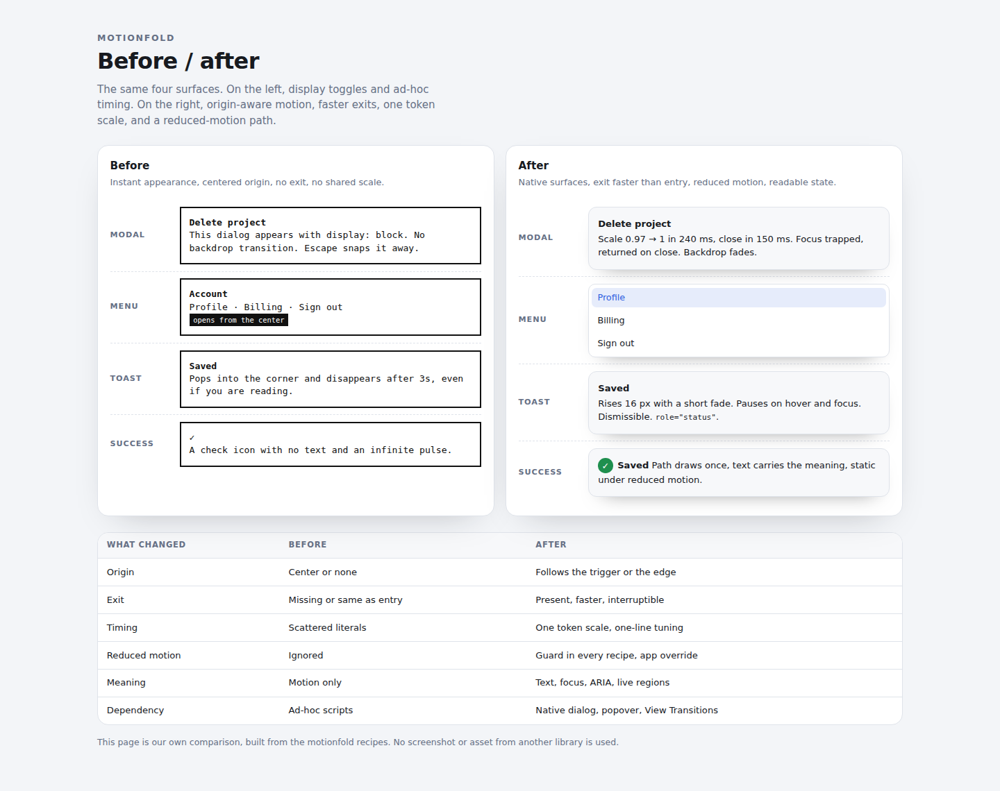
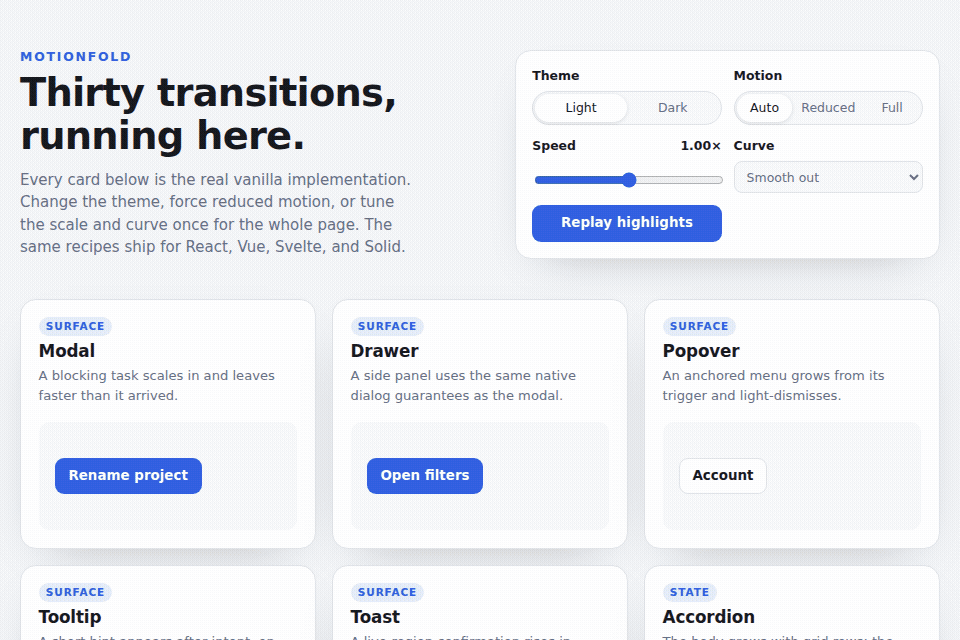
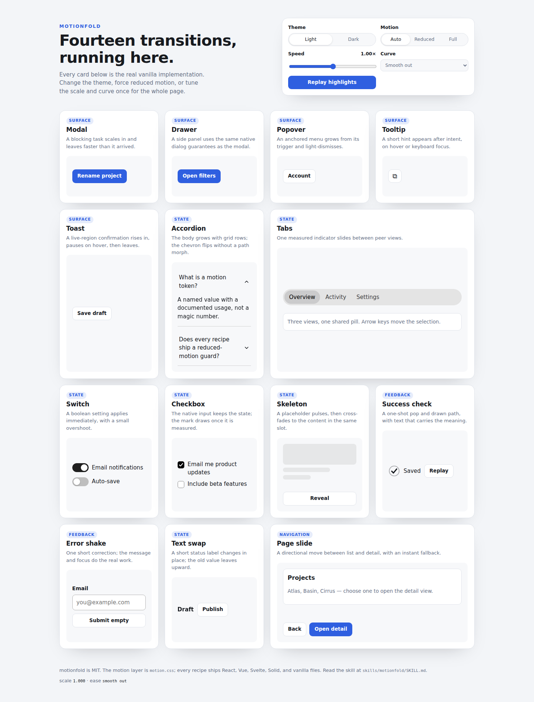
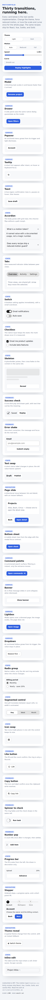
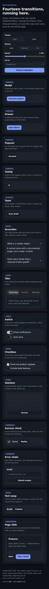

# motionfold

**A deck of thirty polished UI transitions for every stack — accessible by default, tunable in one line.**

```bash
npx skills add terravidhal/motionfold
```

Works with Claude Code, Codex, Cursor, Gemini CLI, GitHub Copilot, OpenCode, and any agent
that reads `SKILL.md`.

Your agent stops hand-rolling keyframes. It picks one of thirty product-focused recipes,
applies the CSS and the implementation for your framework, keeps focus and ARIA intact, and
respects reduced motion.





## What it does

- **Thirty transitions** for real product moments: surfaces, state changes, feedback, and
  navigation.
- **Five stacks, one contract**: vanilla CSS/JS, React, Vue, Svelte, and Solid. Same classes,
  same ARIA, same timing.
- **`prefers-reduced-motion` in every recipe**, plus `data-motion="reduced|full"` for an app
  setting, a demo, or a test.
- **One-line tuning**: `--mf-scale`, `--mf-ease`, or a single recipe token.
- **Native primitives first**: `<dialog>`, Popover API, View Transitions, real inputs, real
  buttons. No animation library.
- **A deterministic local audit** that scans a project, scores its motion, and suggests fixes
  without editing anything.
- **A live demo** that runs offline with a theme toggle, a reduced-motion switch, a speed
  slider, and a curve select.
- **Five mini projects** that import five real recipes each: HTML, React, Vue, Svelte, Solid.

## Install

The one-liner above installs `skills/motionfold/` through the `skills` CLI. If your agent does
not use the CLI, copy the folder manually:

| Agent | Folder |
|---|---|
| Claude Code | `~/.claude/skills/motionfold` |
| Codex | `~/.codex/skills/motionfold` |
| Cursor | `.cursor/skills/motionfold` |
| Gemini CLI | `~/.gemini/skills/motionfold` |
| GitHub Copilot | `.github/skills/motionfold` |
| OpenCode | `~/.config/opencode/skills/motionfold` |

```bash
cp -r skills/motionfold ~/.claude/skills/motionfold
```

The skill installs text only: `SKILL.md`, references, the shared CSS, the recipe CSS, the five
implementations, and the audit script. The demo, the mini projects, the captures, and the
evals stay in the repository.

## The thirty transitions

### Surfaces

| Recipe | Use it when | Avoid it when |
|---|---|---|
| Modal | A blocking decision or focused task | A quick confirmation or a menu |
| Drawer | A side panel for navigation or filters | A short menu or a centered task |
| Bottom sheet | A mobile task rises from the edge | A desktop side panel or a short menu |
| Command palette | A summoned, searchable set of commands | A simple menu or a blocking decision |
| Popover | A menu or action panel anchored to a trigger | A blocking decision or main nav |
| Dropdown | A listbox that keeps the current value visible | A free-form command search |
| Lightbox | Media opens for a closer look | Inline media that should stay in flow |
| Tooltip | A short hint on hover or focus | Essential information or touch only |
| Toast | A transient async confirmation | An error that needs a decision |
| Banner | A page-level message that stays until dismissed | A transient confirmation |

### State

| Recipe | Use it when | Avoid it when |
|---|---|---|
| Accordion | A header reveals a body in place | Primary navigation |
| Tabs | Peer views with a moving indicator | Sequential steps or page navigation |
| Segmented control | Two to four compact peer filters | More than four options |
| Switch | A boolean setting that applies now | A form value submitted later |
| Checkbox | Multiple selection or consent | An instant setting |
| Radio group | One exclusive choice in a small set | An immediate on/off setting |
| Icon swap | Two familiar icons toggle in place | A long label change or three states |
| Skeleton | Loading with a known structure | A very short or unknown wait |
| Progress bar | A task with a known completion | A very short wait or unknown duration |
| Inline edit | A short value can be renamed in place | A long form or cross-field validation |
| Text swap | A short status label changes in place | A paragraph or the main content |

### Feedback

| Recipe | Use it when | Avoid it when |
|---|---|---|
| Success check | An action just succeeded | A passive status change |
| Error shake | One field failed validation | A system failure or the whole form |
| Spinner to check | A short task resolves in the same spot | A long task with a known percentage |
| Like button | A lightweight appreciation toggles | A destructive or quiet action |
| Copy button | A clipboard write succeeds | A destructive or long-running action |
| Number pop | A small count changes on purpose | Continuously updating telemetry |

### Navigation

| Recipe | Use it when | Avoid it when |
|---|---|---|
| Page slide | List ↔ detail, step ↔ step | A keyboard-heavy or frequent path |
| Stepper | Ordered steps in a short wizard | Peer views or a long page flow |
| Theme reveal | A deliberate theme switch deserves a spatial reveal | A theme that must follow the OS instantly |

Full decision rules and exclusions are in
[`skills/motionfold/references/choosing.md`](skills/motionfold/references/choosing.md).

## Tune it

Everything, one line:

```css
:root { --mf-scale: 0.85; --mf-ease: cubic-bezier(0.2, 0.8, 0.2, 1); }
```

One recipe, one line:

```css
:root { --mf-modal-duration: 200ms; --mf-sheet-duration: 280ms; }
```

One instance, one line:

```css
.checkout-dialog { --mf-modal-distance: 0px; --mf-modal-scale: 0.99; }
```

The framework components accept `duration`, `easing`, and `distance`. They only write those
CSS variables; the stylesheet stays the source of truth.

## See it running

```bash
npm run demo
```

Open <http://localhost:4173/examples/index.html>. No build, no dependency. The gallery runs
all thirty recipes, including the new bottom sheet, command palette, banner, lightbox,
dropdown, radio group, segmented control, icon swap, like button, copy button, spinner to
check, number pop, progress bar, stepper, theme reveal, and inline edit.

| Desktop light | Desktop dark |
|---|---|
|  |  |

| Mobile light | Mobile dark |
|---|---|
|  |  |

### Mini projects

Each mini project imports five real recipes from the skill:

| Project | Stack | Recipes |
|---|---|---|
| [`examples/mini/html`](examples/mini/html/) | CSS + vanilla JS, no build | modal, tabs, switch, toast, success check |
| [`examples/mini/react`](examples/mini/react/) | React + Vite | modal, tabs, switch, toast, success check |
| [`examples/mini/vue`](examples/mini/vue/) | Vue + Vite | modal, tabs, switch, toast, success check |
| [`examples/mini/svelte`](examples/mini/svelte/) | Svelte 5 + Vite | modal, tabs, switch, toast, success check |
| [`examples/mini/solid`](examples/mini/solid/) | Solid + Vite | modal, tabs, switch, toast, success check |

The HTML project needs no install. The framework projects carry only their own build
dependencies; those never ship with the skill.

## Audit

```bash
node skills/motionfold/scripts/audit.mjs src/
node skills/motionfold/scripts/audit.mjs src/ --json
node skills/motionfold/scripts/audit.mjs src/ --min-score 80
```

Deterministic, local, read-only. It catches `transition: all`, layout animation, missing
reduced-motion guards, slow durations, untransitioned overlays, and inconsistent timing. See
[`references/audit.md`](skills/motionfold/references/audit.md).

## What it will not do

- Animate a keyboard-heavy action (arrow-key navigation, typing) when the frequency gate says
  no.
- Use `transition: all` or animate layout without a documented reason.
- Make motion the only signal of success, error, or selection.
- Add an animation library or a runtime dependency.
- Copy the recipes, text, or assets of another transitions library. Everything here is written
  for motionfold and released under MIT.

## Repository layout

```text
motionfold/
├── skills/motionfold/       # what `npx skills add` installs
│   ├── SKILL.md             # the agent's instructions
│   ├── recipes.json         # the manifest and source of truth
│   ├── references/          # choosing, tokens, a11y, stacks, audit, recipes
│   ├── implementations/     # 30 recipes x (CSS + 5 stacks)
│   └── scripts/audit.mjs    # local scan
├── examples/
│   ├── index.html           # live demo, zero build
│   ├── mini/                # five framework mini projects
│   ├── before-after.html    # our own comparison page
│   └── scripts/             # capture, GIF, smoke test
├── scripts/                 # repository checks and audit fixtures
├── evals/                   # behavioral evaluation prompts
├── assets/                  # screenshots, GIF, before/after
└── .github/workflows/       # lint and audit fixtures
```

Maintainer checks:

```bash
npm run lint              # frontmatter, manifest, links, JSON, assets, secrets, mini projects
npm run lint:audit-test   # audit fixtures
npm run lint:demo         # Playwright smoke test over the 30 recipes
npm run lint:capture      # screenshots
npm run lint:gif          # assets/demo.gif
npm run demo              # open the demo
```

## License

MIT. `LICENSE`. The recipes, text, screenshots, and GIF are original to this repository.
