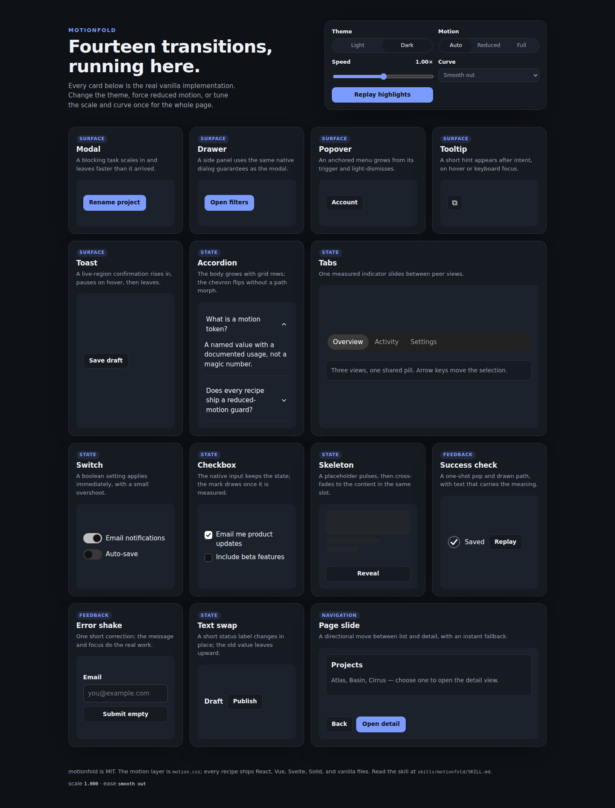

# motionfold

**A deck of polished UI transitions for every stack — accessible by default, tunable in one line.**

```bash
npx skills add terravidhal/motionfold
```

Works with Claude Code, Codex, Cursor, Gemini CLI, GitHub Copilot, OpenCode, and any agent
that reads `SKILL.md`.

Your agent stops hand-rolling keyframes. It picks one of fourteen product-focused recipes,
applies the CSS and the implementation for your framework, keeps focus and ARIA intact, and
respects reduced motion.


## What it does

- **Fourteen transitions** for real product moments: modal, drawer, popover, tooltip, toast,
  accordion, tabs, switch, checkbox, skeleton, success check, error shake, text swap, page slide.
- **Five stacks, one contract**: vanilla CSS/JS, React, Vue, Svelte, and Solid. Same classes,
  same ARIA, same timing.
- **`prefers-reduced-motion` in every recipe**, plus `data-motion="reduced|full"` for an app
  setting, a demo, or a test.
- **One-line tuning**: `--mf-scale`, `--mf-ease`, or a single recipe token.
- **Native primitives first**: `<dialog>`, Popover API, View Transitions, real inputs, real
  buttons. No animation library.
- **A deterministic local audit** that scans a project, scores its motion, and suggests fixes
  without editing anything.
- **A live demo** that runs offline with a theme toggle, a reduced-motion switch, a speed
  slider, and a curve select.

## Install

The one-liner above installs `skills/motionfold/` through the `skills` CLI. If your agent does
not use the CLI, copy the folder manually:

| Agent | Folder |
|---|---|
| Claude Code | `~/.claude/skills/motionfold` |
| Codex | `~/.codex/skills/motionfold` |
| Cursor | `.cursor/skills/motionfold` |
| Gemini CLI | `~/.gemini/skills/motionfold` |
| GitHub Copilot | `.github/skills/motionfold` |
| OpenCode | `~/.config/opencode/skills/motionfold` |

```bash
cp -r skills/motionfold ~/.claude/skills/motionfold
```

The skill installs text only: `SKILL.md`, references, the shared CSS, the recipe CSS, the five
implementations, and the audit script. The demo, the captures, and the evals stay in the
repository.

## The fourteen transitions

| Recipe | Family | Use it when | Avoid it when |
|---|---|---|---|
| Modal | surface | A blocking decision or focused task | A quick confirmation or a menu |
| Drawer | surface | A side panel for navigation or filters | A short menu or a centered task |
| Popover | surface | A menu anchored to a trigger | A blocking decision or main nav |
| Tooltip | surface | A short hint on hover or focus | Essential information or touch only |
| Toast | surface | A transient async confirmation | An error that needs a decision |
| Accordion | state | A header reveals a body in place | Primary navigation |
| Tabs | state | Peer views with a moving indicator | Sequential steps or page navigation |
| Switch | state | A boolean setting that applies now | A form value submitted later |
| Checkbox | state | Multiple selection or consent | An instant setting |
| Skeleton | state | Loading with a known structure | A very short or unknown wait |
| Success check | feedback | An action just succeeded | A passive status change |
| Error shake | feedback | One field failed validation | A system failure or the whole form |
| Text swap | state | A short status label changes in place | A paragraph or the main content |
| Page slide | navigation | List ↔ detail, step ↔ step | A keyboard-heavy or frequent path |

Full decision rules and exclusions are in
[`skills/motionfold/references/choosing.md`](skills/motionfold/references/choosing.md).

## Tune it

Everything, one line:

```css
:root { --mf-scale: 0.85; --mf-ease: cubic-bezier(0.2, 0.8, 0.2, 1); }
```

One recipe, one line:

```css
:root { --mf-modal-duration: 200ms; }
```

One instance, one line:

```css
.checkout-dialog { --mf-modal-distance: 0px; --mf-modal-scale: 0.99; }
```

The framework components accept `duration`, `easing`, and `distance`. They only write those
CSS variables; the stylesheet stays the source of truth.

## See it running

```bash
npm run demo
```

Open <http://localhost:4173/examples/index.html>. No build, no dependency.

| Desktop light | Desktop dark |
|---|---|
|  |  |

| Mobile light | Mobile dark |
|---|---|
|  |  |

## Audit

```bash
node skills/motionfold/scripts/audit.mjs src/
node skills/motionfold/scripts/audit.mjs src/ --json
node skills/motionfold/scripts/audit.mjs src/ --min-score 80
```

Deterministic, local, read-only. It catches `transition: all`, layout animation, missing
reduced-motion guards, slow durations, untransitioned overlays, and inconsistent timing. See
[`references/audit.md`](skills/motionfold/references/audit.md).

## What it will not do

- Animate a keyboard-heavy action (command palette, arrow-key navigation, typing).
- Use `transition: all` or animate layout without a documented reason.
- Make motion the only signal of success, error, or selection.
- Add an animation library or a runtime dependency.
- Copy the recipes, text, or assets of another transitions library. Everything here is written
  for motionfold and released under MIT.

## Repository layout

```text
motionfold/
├── skills/motionfold/       # what `npx skills add` installs
│   ├── SKILL.md             # the agent's instructions
│   ├── recipes.json         # the manifest and source of truth
│   ├── references/          # choosing, tokens, a11y, stacks, audit, recipes
│   ├── implementations/     # 14 recipes x (CSS + 5 stacks)
│   └── scripts/audit.mjs    # local scan
├── examples/                # live demo, before/after, captures, smoke test
├── scripts/                 # repository checks and audit fixtures
├── evals/                   # behavioral evaluation prompts
├── assets/                  # screenshots
└── .github/workflows/       # lint and audit fixtures
```

Maintainer checks:

```bash
npm run lint              # frontmatter, manifest, links, JSON, assets, secrets
npm run lint:audit-test   # audit fixtures
npm run demo              # open the demo
```

## License

MIT. `LICENSE`. The recipes, text, and screenshots are original to this repository.
